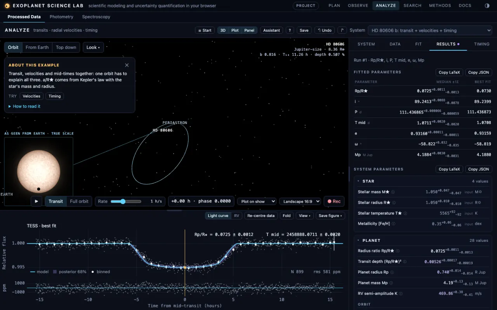
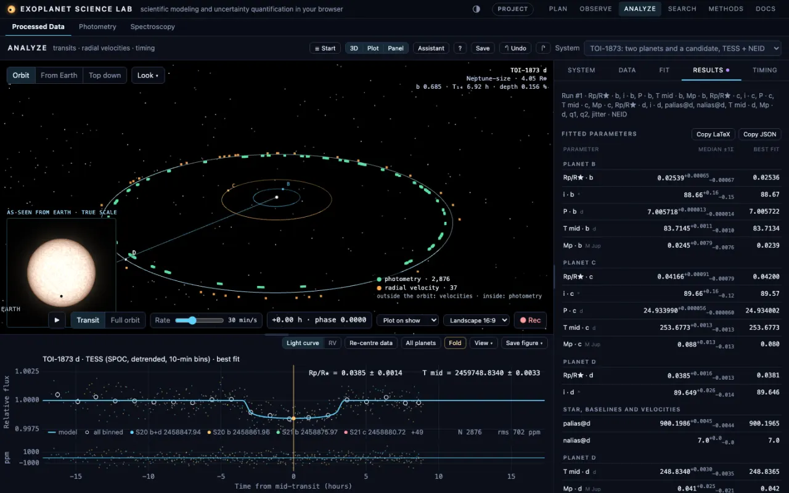
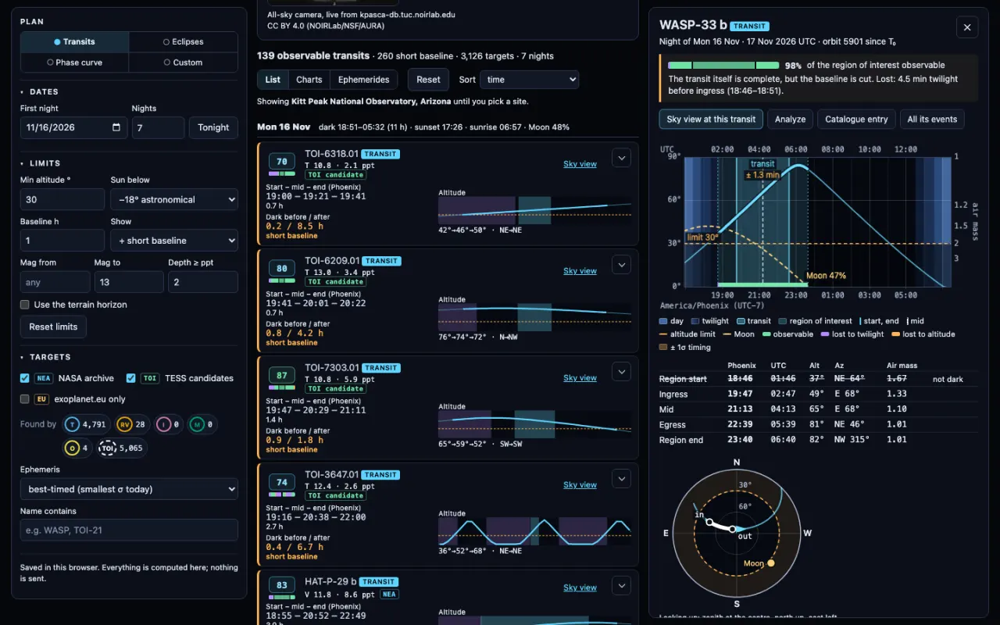
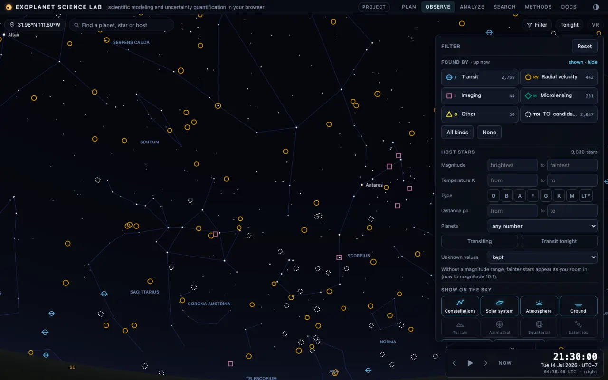

# Exoplanet Science Lab

Plan, observe, reduce and fit exoplanet observations: in the browser, from Python, or through an AI agent over MCP. One science core, tested against independent references.

**[Open the app](https://pearsonkyle.github.io/Exoplanet-Science-Lab/)** · **[Documentation](https://pearsonkyle.github.io/Exoplanet-Science-Lab/docs/)** · [Methods](docs/METHODS.md)

- **Plan** the transits, eclipses and phase-curve windows you can observe from your site.
- **Observe** your sky at any time, with every planet host marked (and a VR mode).
- **Photometry**: FITS frames (folders or zips) or TESS/Kepler/K2 pixels to a light curve, with DS9-style inspection.
- **Fit** transits, radial velocities, timing, phase curves, eclipse maps, moons, Rossiter–McLaughlin and N-body TTVs with nested sampling, and get a methods paragraph with BibTeX.
- **Python** package and **MCP** server on the same core; an **assistant** that drives the site with your own LLM.

Files you open never leave your browser: every science routine (transit and RV models, nested sampling, photometry, plate solving) runs in the page as plain JavaScript, written with Claude Fable 5.2 and checked against the reference codes it reimplements ([Validation](https://pearsonkyle.github.io/Exoplanet-Science-Lab/methods/#validation)).

## A tour

### Analyze



- Fit light curves, radial velocities and transit times together, for one planet or several, with nested sampling (posteriors, evidence, corner plots).
- The 3D view is the model itself: **From Earth** shows the transit at true scale as the light curve sees it, and **Rec** records it as a movie.
- Results export as LaTeX or JSON, and the Results tab writes a methods paragraph with the BibTeX of exactly the methods used.
- Eighteen worked examples, real data (TESS, Kepler, NEID, HIRES and others) and simulations, each with a note on how to read it.

### Data along the orbit



- **Look ▸ Data along the orbit** places every measurement where the planet was when it was taken: velocities just outside the orbit (orange), photometry just inside (green).
- The gaps are the phases nobody observed. A well-sampled RV planet (HD 80606 b) is ringed all the way round.
- A candidate like TOI-1873 d shows its TESS sectors as clumps and its few velocities scattered between them, so you can see why its period is one of several aliases.

### Plan



- Transits, secondary eclipses, phase-curve and custom windows for your site and nights, with timing uncertainty propagated from the ephemeris.
- Each event gets a 0–100 score from its coverage, dark baseline, altitude (airmass) and expected signal-to-noise (depth, host magnitude and duration for a small telescope).
- Pick a site on the globe (89 observatories with links to their weather and all-sky cameras), use a terrain horizon, filter by magnitude, depth and discovery method, and include TESS candidates.
- Every row opens an altitude chart and opens in the sky view or the analyzer, and the ephemerides download as CSV.

### Observe



- Your sky at any time and place, with every planet host marked by how its planets were found, and filters by star type, distance and brightness.
- Satellites (SGP4), the Moon, the planets and bright asteroids, with their paths over a night or months.
- Survey images of any field (DSS2, 2MASS, Pan-STARRS, Legacy Surveys) with Gaia stars and suggested comparison stars, and a VR mode.

### Photometry


- FITS frames (folders or zips) or TESS, Kepler and K2 pixels to a light curve, all in the browser.
- DS9-style inspection, plate solving and Gaia comparison stars.
- A search over aperture radii, annuli and comparison stars, scored with the transit model.

### Timing and hidden companions


- O − C diagrams against a linear ephemeris, periodograms of the timing residuals, and N-body fits of transit-timing variations.
- The companion explorer searches for a hidden planet that would explain the timing variations: Kepler-88 c, which never transits, is weighed from the transit times of b.

### Assistant


- Drives the site through the same controls you use (loading data, fitting, planning), with your own model: LM Studio locally or any OpenAI-compatible server.
- Explains the methods with their equations, taken from the Methods page and the code.
- Checks every number it quotes against the results and flags the ones it cannot find.

## Run it locally

Needs [Node.js](https://nodejs.org) 20+.

```sh
git clone https://github.com/pearsonkyle/Exoplanet-Science-Lab.git
cd Exoplanet-Science-Lab
npm install
npm run dev          # http://localhost:5173
```

`npm run build` writes the static site to `dist/`.

## Python

```sh
pip install "git+https://github.com/pearsonkyle/Exoplanet-Science-Lab.git#subdirectory=python"
```

```python
import esl
fit = esl.Session.load("session.json").run(progress=True)   # a session saved from the Analyze page
print(fit.result.table())
```

## MCP server (Claude Desktop, Claude Code, Cursor, …)

```sh
cd mcp && npm install
claude mcp add exoplanet-science-lab -- node "$PWD/server.mjs" --workspace ~/esl-work
```

Other clients, HTTP, remote machines and setting up your own LLM for the in-page assistant: see the [docs](https://pearsonkyle.github.io/Exoplanet-Science-Lab/docs/guide/mcp.html).

## Tests

```sh
npm test                       # every Node suite (~15 min)
cd python && pytest            # the Python package
cd mcp && npm test             # the MCP server
```

## Cite

Please cite the software (`CITATION.cff`) and the papers of the methods you used: the app's Results tab writes a methods paragraph with exactly those references.

## Licence

MIT, see [LICENSE](LICENSE). Bundled data keep their own terms (catalogues, EXOTIC sample frames, published velocities); each example's README and the Methods page list the sources.
