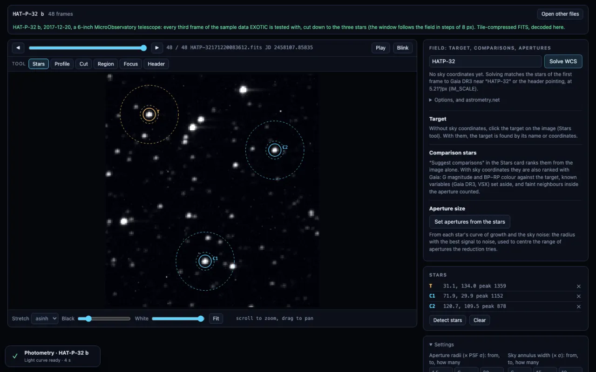
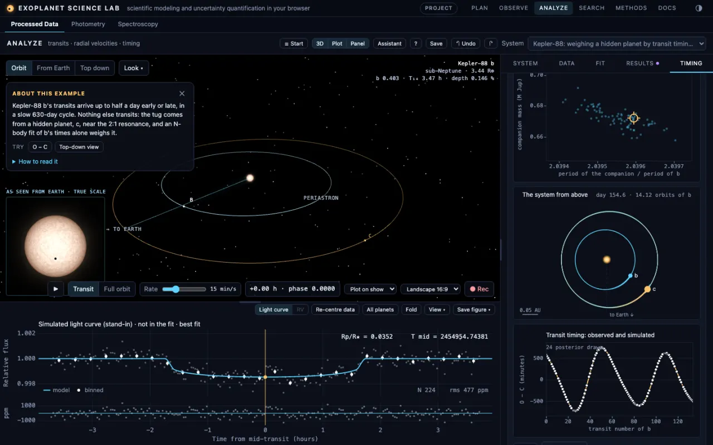
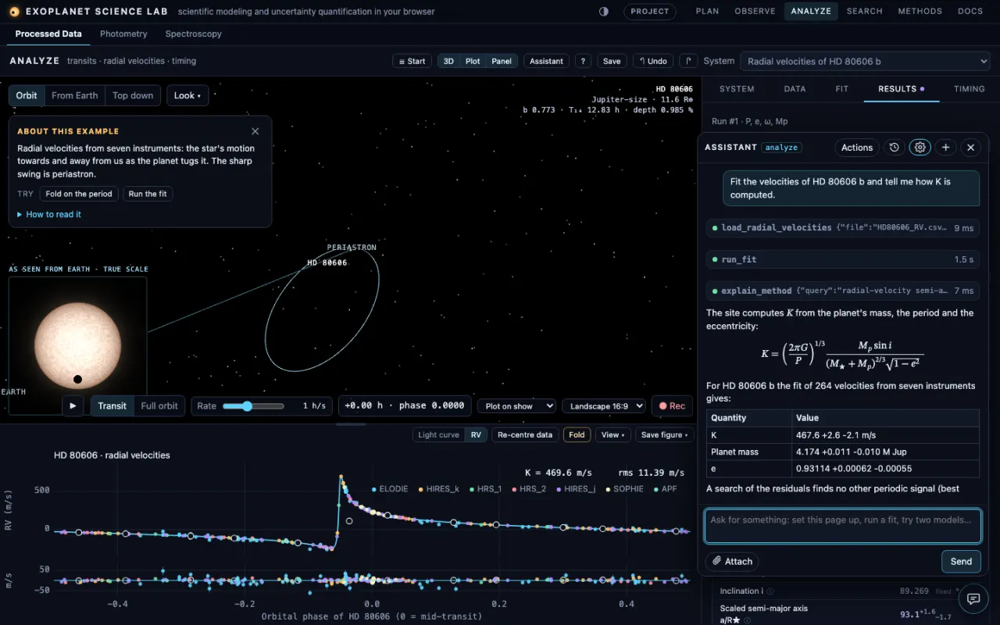

# Exoplanet Science Lab

Plan, observe, reduce and fit exoplanet observations: in the browser, from Python, or through an AI agent over MCP. One science core, tested against independent references.

**[Open the app](https://pearsonkyle.github.io/Exoplanet-Science-Lab/)** · **[Documentation](https://pearsonkyle.github.io/Exoplanet-Science-Lab/docs/)** · [Methods](docs/METHODS.md)

- **Plan** the transits, eclipses and phase-curve windows you can observe from your site.
- **Observe** your sky at any time, with every planet host marked (and a VR mode).
- **Photometry**: FITS frames (folders or zips) or TESS/Kepler/K2 pixels to a light curve, with DS9-style inspection.
- **Fit** transits, radial velocities, timing, phase curves, eclipse maps, moons, Rossiter–McLaughlin and N-body TTVs with nested sampling, and get a methods paragraph with BibTeX.
- **Python** package and **MCP** server on the same core; an **assistant** that drives the site with your own LLM.

Files you open never leave your browser.


<table>
<tr>
<td width="50%"><br><sub><b>Plan</b>: transits you can observe from your site, ranked by coverage, altitude and the expected signal for a small telescope.</sub></td>
<td width="50%"><br><sub><b>Observe</b>: your sky, planet hosts marked by how they were found, filters by star type and distance.</sub></td>
</tr>
<tr>
<td><br><sub><b>Photometry</b>: FITS frames to a light curve, with plate solving and Gaia comparison stars.</sub></td>
<td><br><sub><b>Timing</b>: a hidden planet weighed from transit-timing variations (Kepler-88).</sub></td>
</tr>
<tr>
<td colspan="2"><br><sub><b>Assistant</b>: runs the analysis through the same controls, explains the methods with their equations, and checks every number it quotes against the results.</sub></td>
</tr>
</table>

## Run it locally

Needs [Node.js](https://nodejs.org) 20+.

```sh
git clone https://github.com/pearsonkyle/Exoplanet-Science-Lab.git
cd Exoplanet-Science-Lab
npm install
npm run dev          # http://localhost:5173
```

`npm run build` writes the static site to `dist/`.

## Python

```sh
pip install "git+https://github.com/pearsonkyle/Exoplanet-Science-Lab.git#subdirectory=python"
```

```python
import esl
fit = esl.Session.load("session.json").run(progress=True)   # a session saved from the Analyze page
print(fit.result.table())
```

## MCP server (Claude Desktop, Claude Code, Cursor, …)

```sh
cd mcp && npm install
claude mcp add exoplanet-science-lab -- node "$PWD/server.mjs" --workspace ~/esl-work
```

Other clients, HTTP, remote machines and setting up your own LLM for the in-page assistant: see the [docs](https://pearsonkyle.github.io/Exoplanet-Science-Lab/docs/guide/mcp.html).

## Tests

```sh
npm test                       # every Node suite (~15 min)
cd python && pytest            # the Python package
cd mcp && npm test             # the MCP server
```

## Cite

Please cite the software (`CITATION.cff`) and the papers of the methods you used: the app's Results tab writes a methods paragraph with exactly those references.

## Licence

MIT, see [LICENSE](LICENSE). Bundled data keep their own terms (catalogues, EXOTIC sample frames, published velocities); each example's README and the Methods page list the sources.
